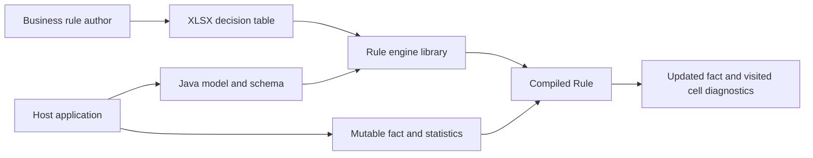
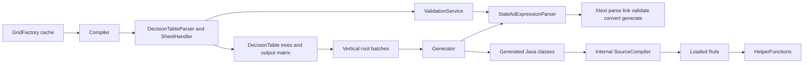
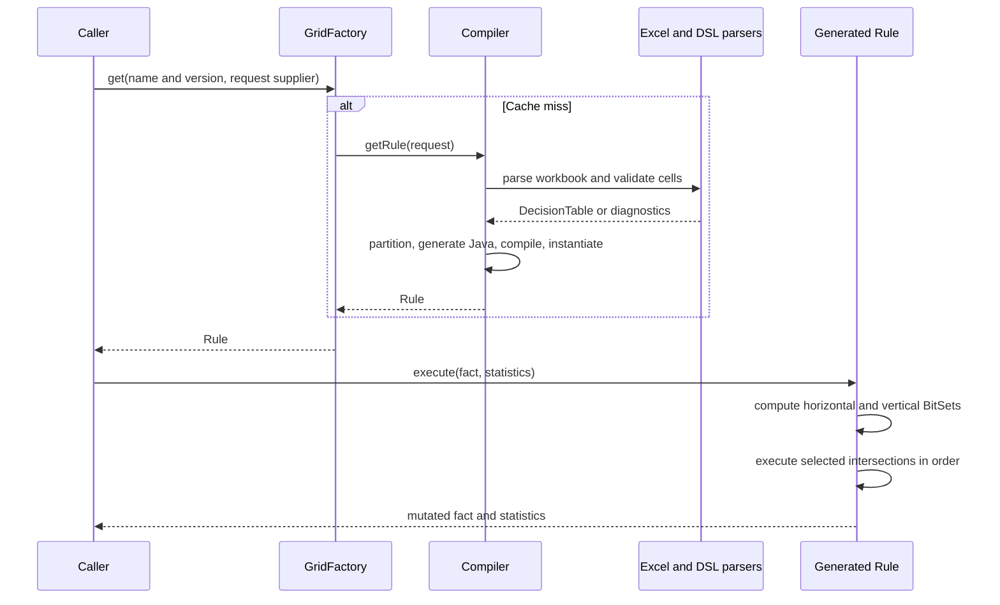
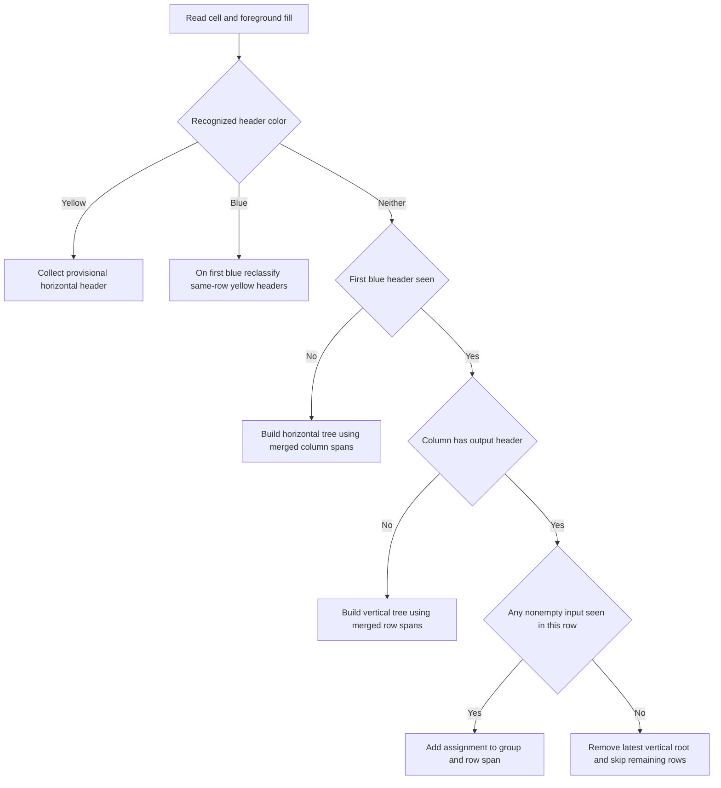
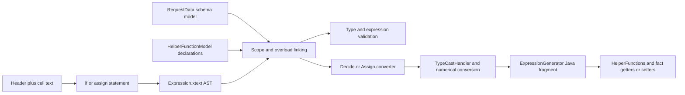
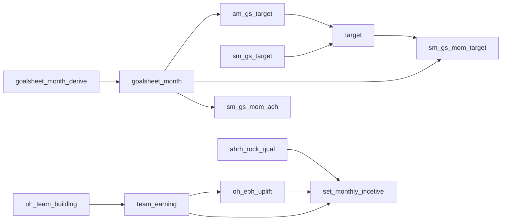

> Historical redmine architecture. Active work moved to main-based feature branches on 16 October 2026. Read [MAIN_BRANCH_MAP.md](MAIN_BRANCH_MAP.md) and [MEMORY_MAP.md](MEMORY_MAP.md) first; parser/type/helper conclusions and source line links below describe the earlier branch unless explicitly identified as shared.

# Rule engine architecture and Excel semantics

This workspace implements an Excel-authored, two-dimensional decision table engine and a separate expression language. A caller supplies an XLSX stream, a typed Java model and a schema. The engine reads the first worksheet, constructs horizontal and vertical decision trees, generates Java, compiles it, and mutates the supplied model through its setters. Yellow and blue identify **headers**; tree position and merged ranges determine how conditions and outputs relate. The implementation is the authority for its match semantics; similarity to Drools, ACTICO or Camunda does not establish compatibility with their languages or hit policies. [Compiler:31][compiler], [SheetHandler:155][sheet], [Generator:40][generator]

Start with [MEMORY_MAP.md](MEMORY_MAP.md) for quick navigation. This document supplies the detailed explanation, examples, change locations and limitations. The machine-readable [snapshot](evidence/snapshot.json), [source index](evidence/source-index.json), [workbook index](evidence/workbook-index.json) and [sample field index](evidence/sample-fields.json) preserve the evidence and support later lookups.

Working-tree update, 15 October 2026: plain Java application function registration is implemented locally. Register once and give the immutable registry to `GridFactory`; custom functions always use explicit arguments. The [walkthrough](FUNCTION_REGISTRATION_WALKTHROUGH.md) and [added-line ledger](FUNCTION_REGISTRATION_LINES.md) explain every change. A focused build compiled the current parser/runtime/engine sources and passed all 44 existing engine tests plus 15 new registration tests. This is not a published release or a successful full Eclipse/Tycho reactor build. [Executed evidence](evidence/registration-check.json)

## 1 Whole workspace technical map

### 1.1 Scope and terminology

The containing directory is not a Git repository. `rule-engine/` and `rule-engine-expression-parser/` are independent repositories; `Grid-3.0/Grid-3.0/` contains business examples. Both existing READMEs are GitLab starter templates, so they do not describe the actual architecture. The source and manifests below establish it. [Engine README][readmee], [Parser README][readmep]

| Term | Meaning here |
|---|---|
| Fact / request data | Mutable Java object passed to `Rule.execute(Object, RuleStatistics)` |
| Schema | Field names, types and optional possible values; also a flag for metadata columns |
| Decision header | Yellow cell naming the variable tested by associated condition cells |
| Horizontal decision | Condition above the output header row; selects an output column group |
| Vertical decision | Condition below that row and to the left of outputs; selects a data row |
| Assign header | Blue cell naming the variable assigned by output cells |
| Assign span group | One horizontal result group containing data-row spans and output cells |
| Rule | Compiled Java object; not one Excel row |
| Batch | Generated class containing a partition of vertical root subtrees |
| Expression parser | Xtext runtime used by `StatefulExpressionParser`; distinguish it from the older engine-local class also named `ExpressionParser` |

Evidence: [API][rule], [Schema][schema], [table model][table], [cell model][cell], [adapter][adapter], [compiler][compiler].

### 1.2 Detected stack

| Layer | Technology in this checkout | Evidence |
|---|---|---|
| Engine artifact | `com.act21.impaktapps:rule-engine:13.0.93` | [Engine POM:5][epom] |
| Engine language | Java source and target 17; Maven compiler plugin 3.10.1 | [Engine POM:117][epom] |
| XLSX parsing and writing | Apache POI / POI OOXML 3.17; SAX reader and XSSFWorkbook writer | [Engine POM:25][epom], [table parser][dtparser], [writer][writer] |
| Expression runtime dependency | `com.act21.rule.engine.dsl.expression.runtime:1.0.43` | [Engine POM:40][epom] |
| Expression project | Java, Xtend, Xtext grammar; Java source/target 11 | [Parser parent POM:16][ppom] |
| Language generation | Xtext 2.28.0, MWE2 2.13.0, Tycho 2.7.4 | [Parser parent POM:16][ppom], [MWE workflow][mwe] |
| Dynamic Java compilation | Internal `com.act21:java-compiler:1.0.0`, `SourceCompiler` | [Engine POM:73][epom], [Compiler:39][compiler] |
| Cache | Guava 33.1.0-jre `LoadingCache` | [Engine POM:35][epom], [GridFactory:32][cache] |
| Serialization | Jackson; engine declares `jackson-core` twice, 2.14.2 and 2.15.2 | [Engine POM:95][epom], [Commons:25][commons] |
| Logging | SLF4J 1.7.35 and provided Log4j 2.20.0 in engine; runtime SLF4J 1.7.30 | [Engine POM][epom], [runtime POM][rpom] |
| Tests | JUnit Jupiter 5.9.3 engine tests; Xtext/JUnit 5 plugin test sources | [Engine POM:79][epom], [parser test manifest][ptestmanifest] |
| Editor integration | Eclipse UI, IDE, target-platform and UI-test modules | [Parser parent POM:30][ppom] |

### 1.3 Directory and source ownership

Paths in the first table are relative to `rule-engine/src/main/java/com/act21/impaktapps/rule/engine/`. All 28 production Java files are represented. Method navigation, imports, line counts and SHA-256 hashes are in [source-index.json](evidence/source-index.json).

| Package / files | Responsibility and useful entry points |
|---|---|
| `api/Rule.java`, `RuleStream.java` | Execution contract; closeable source stream |
| `api/RuleCreationRequest.java` | Builder, defaults, input checks, creation of the per-request parser |
| `api/Schema.java`, `PropertySchema.java` | Schema map, metadata flag, `Type`, possible values |
| `api/DecisionMatchType.java`, `RuleStatistics.java` | Three match modes; visited cell and selected vertical row diagnostics |
| `cache/GridIdentifier.java`, `GridFactory.java` | Name/version identity, lazy compilation cache |
| `compiler/Compiler.java`, `Generator.java` | Read, validate, partition, generate, compile and instantiate rules |
| `table/DecisionTableParser.java` | Two SAX passes over the first worksheet |
| `handler/SheetHandler.java` | Streaming state machine; color, merge, tree and output-matrix construction |
| `table/DecisionTable.java`, `DtCell.java`, `DtCellType.java` | Intermediate representation, coordinates, children, headers and spans |
| `table/StatefulExpressionParser.java` | Active adapter to Xtext; wraps cells in `if` / `assign` statements |
| `table/ExpressionParser.java` | Older regex-based converter. No active production call site found in this checkout |
| `validation/ValidationService.java`, `ValidationMessage.java` | Layout, schema, metadata and expression validation; template comparison |
| `exception/ParsingException.java` | Carries validation message list |
| `commons/Constants.java`, `Commons.java` | Exact colors, metadata names, schema reflection, dates, cell diagnostics |
| `service/RuleDataFormatter.java` | Shared strings, Boolean values and POI numeric display formatting |
| `service/RuleService.java`, `ExcelWriter.java` | Table-to-map export, template-plus-map reconstruction, XLSX writing |
| `migrator/Migrator.java`, `MigratorService.java` | Conversion of selected older string cells into quoted DSL expressions |

The parser repository contains a parent Maven reactor and seven modules:

| Module suffix | Responsibility |
|---|---|
| `expression` | Grammar, EMF/Xtext setup, scoping/linking, type system, AST conversion, validation and Java expression generation |
| `expression.Runtime` | Standalone `ExpressionParser`, request-schema model builder, `VariableSchema`, executable `HelperFunctions` |
| `expression.ide` | Xtext IDE setup/module |
| `expression.ui` | Eclipse editor registration and extension stubs for completion, labels, outline and quick fixes |
| `expression.target` | Eclipse p2 target-platform definitions |
| `expression.tests` | Parsing, generated-expression and validation examples |
| `expression.ui.tests` | Eclipse UI test bundle scaffolding |

The on-disk runtime directory uses `.Runtime`; the parent module entry uses `.runtime`. Windows resolves that difference; a case-sensitive filesystem needs attention. Generated `src-gen`, `xtend-gen`, target and model artifacts are not the handwritten language source. MWE2 generates the parser/model; Xtend compilation generates Java from `.xtend`. [Parent POM:30][ppom], [DSL POM:14][dpom], [MWE workflow:10][mwe], [parser ignore file][pignore]

### 1.4 Commands and verification inventory

These are Maven lifecycle commands grounded in the manifests, not claims that the full builds passed. Run engine commands from `rule-engine/` and parser commands from `rule-engine-expression-parser/com.act21.rule.engine.dsl.expression.parent/`.

| Command | Purpose / qualification | Evidence |
|---|---|---|
| `mvn test` | Engine compile and test lifecycle | [Engine POM][epom], [engine tests][tests] |
| `mvn -Dtest=DecisionParserTests#testcase1 test` | Target engine test; requires a working JUnit-capable Surefire setup. Surefire version is not pinned in the POM | [engine tests:48][tests], [Engine POM:117][epom] |
| `mvn package` / `mvn install` | Engine JAR / local artifact installation | Engine Maven JAR project [POM][epom] |
| `mvn verify` / `mvn install` | Parser reactor build, generation and plugin tests / local installation | [Parent POM][ppom], [DSL POM][dpom] |
| `mvn -DskipTests verify` | Skip test execution while retaining compilation | [Parent POM:202][ppom] |
| `mvn -Dmaven.test.skip=true verify` | Skip test compilation and execution | [Parent POM:202][ppom] |
| `mvn -Dtest=ExpressionParsingTest verify` | Candidate targeted parser test invocation; Tycho selection behavior is **unverified here** | [Tycho configuration:206][ppom] |
| `python tools/memory_map.py check` | Workspace-root freshness check against indexed source/workbook hashes | [inventory utility](../tools/memory_map.py) |
| `python tools/memory_map.py build` | Refresh machine indexes; does not update narrative conclusions automatically | [inventory utility](../tools/memory_map.py) |

No dedicated lint/format command, Maven wrapper, executable service launcher, Docker setup or CI workflow was found in the two checkouts. CI enforcement and branch protections are **unverified**; a README's GitLab CI suggestions are not a configured pipeline. Java compilation is the visible static type check. [Source inventory](evidence/source-index.json), [READMEs][readmee]

The engine tests configure `sourceCodeDirectory` as `<working-directory>/src-gen`. `Compiler.writeToFile` does not create that directory. Create it before running those tests. Run from the engine directory if using their relative conventions. The request API itself permits omitting source dumping. [Tests:1102][tests], [Compiler:151][compiler]

Observed verification on 14 October 2026:

| Check | Actual result |
|---|---|
| Engine branch selection | Switched to local tracking branch `redmine-19600`, commit `f694d31bea1b6ac93db61760fe1be62348dec1ff` |
| Remote pull | `git pull --ff-only origin redmine-19600` failed to connect through configured `127.0.0.1:9`; remote freshness not confirmed |
| Engine Maven test, offline | Stopped at missing cached internal expression runtime 1.0.43; no engine tests ran. [Log](evidence/engine-build.log) |
| Parser Maven verify, offline | Stopped during Tycho/Equinox initialization: `Unable to create lock manager`; no parser tests ran. [Log](evidence/parser-build.log) |
| Actual 1.0.43 `HelperFunctions.java` | Compiled directly with JDK 17.0.9 and passed 15 characterization checks. [Probe source](../tools/HelperSemanticsProbe.java), [results](evidence/helper-probe.txt) |
| Workbook inspection | OOXML read directly for all 65 non-lock workbooks, including styles, cached values and merges. Independently compared 1,682 nonempty cached cell values plus all sheet names/merge ranges in the 17 business workbooks against openpyxl; all agreed. No workbook rewritten |

Follow-up verification on 15 October 2026: `python tools/registration_check.py --offline --test 'RegisteredFunctionsTest,DecisionParserTests'` passed all **59 tests**, using current DSL/runtime/engine source and regenerated Xtend output. [Results](evidence/registration-check.json). A new full Tycho attempt stopped resolving its OSGi runtime dependencies before compilation; see [attempt log](../output/registration-parser-build.log). The original baseline build failures above are historical.

The local Maven directory has a Unix launcher but no `mvn.cmd`. The recorded build checks used its Plexus launcher through Java; that tooling workaround is separate from repository code. The current source pair passed the focused 59-test run; independently packaged release artifacts and the full Tycho reactor remain unverified.

To reproduce the dependency-free helper probe from the containing workspace root with a JDK on PATH:

```powershell
$helperSource = 'rule-engine-expression-parser/com.act21.rule.engine.dsl.expression.parent/com.act21.rule.engine.dsl.expression.Runtime/src/com/act21/rule/engine/dsl/expression/runtime/HelperFunctions.java'
New-Item -ItemType Directory -Force output/memory-probe | Out-Null
javac -d output/memory-probe $helperSource tools/HelperSemanticsProbe.java
java -cp output/memory-probe HelperSemanticsProbe
```

The probe intentionally characterizes current edge cases, including observed exceptions; changing an assertion after a fix requires reviewing the associated language semantics. Its success is not a substitute for engine/parser integration tests.

### 1.5 Runtime and deployment surface

| Surface | Pin / implication | Evidence |
|---|---|---|
| Engine Java compilation | 17 | [Engine POM:124][epom] |
| Parser Java compilation | 11 | [Parent POM:20][ppom] |
| Eclipse bundles | JavaSE-11 in bundle execution environments | [DSL manifest][manifest], [test manifest][ptestmanifest] |
| Generated rule execution | Loaded into caller JVM; compiler uses thread context classloader, so model and helper classes must be visible there | [Compiler:39][compiler], [Generator:64][generator] |
| Language target platform | Eclipse target definitions resolve platform/Xtext plugin dependencies | [target definition][target], [target specification][tpd] |
| Artifact storage | Private ACT21 Artifactory is a dependency and publication destination | [Engine POM:10][epom], [Parent POM:7][ppom] |
| Production JVM/container/database | No deployment pin or database adapter present in these repositories | [source inventory](evidence/source-index.json) |

Dependency maintenance status is **unverified**, not an EOL determination. Pins needing deliberate review during future upgrades include POI 3.17, Xtext 2.28.0/Tycho 2.7.4, commons-lang 2.6, different Jackson versions across modules, and the private Java compiler. No external lifecycle or vulnerability claims are made here. This task documents behavior rather than changes those dependencies.

### 1.6 Eclipse target setup and the observed certificate failure

Diagnostic follow-up, 14 October 2026: the workspace at `rule-engine-eclipse-wkspc/` reports Eclipse build `4.30.0.20231201-1200`, Java 17.0.9 (Adoptium), Windows x86_64. Its `.metadata/.plugins/org.eclipse.core.runtime/.settings/org.eclipse.pde.core.prefs` already selects the checked-in `.target` file. The [workspace log](../rule-engine-eclipse-wkspc/.metadata/.log#L73) records `SSLHandshakeException: PKIX path building failed` and `unable to find valid certification path to requested target`; the repeated "Unable to read repository" messages are wrappers around this TLS trust failure.

The actual installed launcher configuration, `C:/Users/Sumit_Mishra/eclipse/jee-2023-12/eclipse/eclipse.ini`, selects this runtime:

```text
C:/Users/Sumit_Mishra/.p2/pool/plugins/org.eclipse.justj.openjdk.hotspot.jre.full.win32.x86_64_17.0.9.v20231028-0858/jre
```

Its default Java `cacerts` was read successfully and contains no Act21-named certificate. An HTTPS connection to download.eclipse.org presents an issuer named **Act21 Proxy Inspection CA**. That CA is already present in both Windows CurrentUser/Root and LocalMachine/Root stores. The SHA-256 of the matching installed CA is `472FD099EB7EE17B7D5DAB83C0AC8641A8B6D2AE9976B80CBDD458ABFE621F36`, expiring 5 September 2036. These observations explain why a Windows/browser/Python connection can succeed while this Eclipse JVM rejects the certificate. No truststore, Eclipse configuration or target source was changed during this diagnostic.

Read-only repository checks reached metadata at all seven configured repository roots:

| Repository | Metadata reached |
|---|---|
| Orbit R20220302172233 | `p2.index`, `compositeContent.xml` |
| Eclipse releases/2022-09 | `p2.index`, `compositeContent.jar` |
| Eclipse updates/4.25 | `p2.index`, `compositeContent.jar`, redirects to archive.eclipse.org |
| LSP4J 0.15.0 | `p2.index`, `content.xml.xz`, redirects to archive.eclipse.org |
| Modelserver 0.8.0.I20220315 | `p2.index`, `content.jar`, `content.xml.xz` |
| emfjson-jackson 2.0.0 | `content.jar`; p2.index/content.xml returned 404 |
| Jetty 9.4.48.v20220622 | `content.jar`; p2.index/content.xml returned 404 |

These checks establish metadata availability from the diagnostic process, not successful resolution/download of every target bundle inside Eclipse. A missing plain content.xml does not by itself invalidate a p2 repository. Keep repository root URLs in the TPD; do not append content.xml or content.jar. There is no evidence here that the pinned versions need replacing to fix this failure.

The setup sequence for this checkout is:

1. Import `rule-engine-expression-parser/com.act21.rule.engine.dsl.expression.parent/` through **File > Import > Maven > Existing Maven Projects**, including its modules. The target module contains both `.tpd` and generated `.target`. Eclipse needs PDE; Xtext/Xtend tooling is needed for language development. The POM pins Xtext 2.28.0 and Java source/target 11; the Eclipse host JVM and engine Java 17 setting are separate concerns.
2. Fix the actual Eclipse host runtime's certificate trust. Export the existing **Act21 Proxy Inspection CA** from `certmgr.msc > Trusted Root Certification Authorities > Certificates`, choosing **All Tasks > Export > Base-64 encoded X.509 (.CER)**. Verify it is the installed CA identified above (or obtain the current company CA from IT). Exporting a root CA requires no private key.
3. Close Eclipse, back up that runtime's `lib/security/cacerts`, and use its own `bin/keytool.exe` to import the certificate. The example below assumes it was exported to the indicated path. `keytool` prompts for the store password and certificate confirmation; the current default store accepted `changeit` during the read-only check. Do not run the command against an unrelated JDK merely because it is on PATH.

```powershell
$eclipseRuntime = 'C:\Users\Sumit_Mishra\.p2\pool\plugins\org.eclipse.justj.openjdk.hotspot.jre.full.win32.x86_64_17.0.9.v20231028-0858\jre'
& "$eclipseRuntime\bin\keytool.exe" -importcert -cacerts -alias act21-proxy-ca -file 'D:\hyperform_3.0_backend\rule-engine\output\act21-proxy-ca.cer'
```

Oracle documents the Java cacerts location, certificate fingerprint verification, and interactive import in its [keytool reference](https://docs.oracle.com/en/java/javase/17/docs/specs/man/keytool.html). Changing **Java > Installed JREs** alone does not switch the JVM running Eclipse; the launcher `-vm` option controls that JVM. See [Eclipse launcher configuration](https://help.eclipse.org/latest/topic/org.eclipse.platform.doc.isv/reference/misc/launcher_ini.html). Trusting the corporate CA preserves certificate validation; disabling TLS verification is not a necessary fix.

4. Restart Eclipse. Open the existing [target definition][target] using **Open With > Target Editor**, let locations resolve, and select **Set as Active Target Platform**. Alternatively use **Window > Preferences > Plug-in Development > Target Platform**, select **RuleEngine 2022-09**, choose **Reload**, then Apply/OK. The recorded workspace already selects that target, so reloading after the certificate fix is sufficient to retry resolution. [PDE target platform preferences](https://help.eclipse.org/latest/topic/org.eclipse.pde.doc.user/guide/tools/preference_pages/target_platform.htm)
5. When changing the TPD, right-click the [TPD source][tpd], choose **Create Target Definition File** (Alt+R), then activate the resulting `.target`. The CBI TPD plug-in provides this generator; its official update site is `https://download.eclipse.org/cbi/updates/tpd/`. The plug-in is already executing in the recorded log, so reinstalling it is not indicated by this error. Using an existing `.target` needs PDE, without regenerating the TPD. [CBI generator instructions](https://github.com/eclipse-cbi/targetplatform-dsl#basic-usage)
6. After the target resolves, run **Project > Clean** and build the imported projects. Any subsequent missing-IU/version conflict is a separate diagnostic; target resolution and full project tests remain unverified until rerun.

If a connection error remains, inspect **Window > Show View > Other > General > Error Log** for its innermost cause. Configure **General > Network Connections** to suit the actual company network: Native uses OS-discovered settings, Manual uses configured proxies, and Direct uses no proxy. This setting does not itself install the missing Java CA certificate. [Eclipse network preferences](https://help.eclipse.org/latest/topic/org.eclipse.platform.doc.user/reference/ref-net-preferences.htm)

Remediation follow-up, 14 October 2026: the user exported the CA and performed the import. A subsequent read-only `keytool -list` confirmed alias `act21-proxy-ca` in this runtime's default cacerts with the exact SHA-256 recorded above. The initial password-entry failure left cacerts identical to the backup; the verified password was `changeit` (no space). The missing-CA observation above describes the pre-import state. Eclipse restart, target reload and complete target resolution still require verification.

Freshness note: this follow-up found changed Eclipse `.classpath` files and newly generated `xtend-gen` Java files. The target/TPD/POM source relevant to this diagnosis was unchanged. The original evidence snapshot has deliberately not been rebuilt over these user-generated changes; `memory_map.py check` will report that drift until reviewed.

## 2 Checkout context and integration boundaries

### 2.1 Exact snapshot

| Repository | Branch | Commit | Version |
|---|---|---|---|
| `https://git.act21.io/products/rule-engine.git` | `redmine-19600` | `f694d31bea1b6ac93db61760fe1be62348dec1ff` | Engine 13.0.93; parser dependency 1.0.43 |
| `https://git.act21.io/products/rule-engine-expression-parser.git` | `redmine-19600` | `e4614287f57b5565d01ab01c60dd8d7e14871896` | Parser 1.0.43 |

Identity and file hashes: [snapshot.json](evidence/snapshot.json). No license grant was found in a license file; the starter README's License section is not a license. No pre-existing AGENTS/contributor instructions were found. The root [AGENTS.md](../AGENTS.md) added with this reference directs future work to the compact map and freshness checks.

The user confirmed that parser 1.0.43 is the intended version, authorized switching the engine to `redmine-19600`, and permitted schema inference from samples and tests. Business schemas and the surrounding application were not supplied. The memory pack therefore distinguishes inferred fields/types and suggested execution sequences from code that is actually present.

### 2.2 What the surrounding application supplies

The library has no HTTP controller, database connection, job scheduler or global grid workflow. Its caller supplies the workbook stream, model class, schema, chosen match mode, versioning policy, fact initialization, and sequence of grid executions. `RuleService` accepts maps described as database rows but performs no database I/O itself. [Rule API][rule], [request builder][request], [RuleService:36][service]

The private `java-compiler` dependency is a separate artifact. Its implementation is not in either repository. Consequently compiler classloader internals, diagnostic ordering and compiled-result ordering cannot be established from this checkout; the engine currently takes the first returned compiled result as its entry rule. [Compiler:75][compiler]

### 2.3 Calling the engine

The tests demonstrate the actual integration pattern. This example uses their existing `Variable` class and `matchAll.xlsx`; it is illustrative code, not an additional executed test:

```java
String model = "com.act21.impaktapps.rule.engine.test.Variable";
Map<String, PropertySchema> properties = Commons.getPropertySchemaMap(model);
GridFactory factory = new GridFactory(); // retain this to reuse compiled rules
Rule rule = factory.get(new GridIdentifier("matchAll", 2L), key -> {
    InputStream input = Thread.currentThread().getContextClassLoader()
        .getResourceAsStream("matchAll.xlsx");
    RuleStream stream = new RuleStream() {
        public InputStream getInputStream() { return input; }
        public void close() throws IOException { input.close(); }
    };
    return RuleCreationRequest.getRuleRequestBuilder()
        .withName(key.getName()).withVersion(key.getVersion())
        .withModelClassName(model).withRuleStream(stream)
        .withSchema(new Schema(properties, false))
        .withDecisionMatchType(DecisionMatchType.MATCH_ALL)
        .withDoValidate(true).withIgnoreCase(false).build();
});
Variable fact = new Variable();
fact.setInput1("1");
RuleStatistics statistics = new RuleStatistics();
rule.execute(fact, statistics);
// Existing testcase1 asserts fact.getOutput1() == ["1", "2", "4"].
```

Open the stream inside the cache loader so cache hits do not allocate unused streams. The compiler closes `RuleStream`; the cache stores the compiled `Rule`, not the stream. Do not reuse a consumed stream after an eviction/recompile or for a second independent parse. The engine's return is `void`; read outputs from the fact. [Tests:48 and 1081][tests], [GridFactory:35][cache], [Compiler:44][compiler]

| Builder setting | Default / requirement |
|---|---|
| `name`, `ruleStream`, `version` | Required by `validateInputs`; the apparent fallback version 1 is unreachable when version is null |
| `modelClassName`, `schema` | Not checked by the builder, but needed by normal compilation/generation |
| `rulesPerFile` | 300 vertical roots; 0 disables partitioning |
| `ignoreCase` | false |
| `decisionMatchType` | `MATCH_AND_EXIT` |
| `doValidate` | true |
| `sourceCodeDirectory` | null: no generated-source files written |
| `restrictedChars` | Per-builder copy of defaults containing `|`, captured as an immutable set on the built request |

Evidence: [RuleCreationRequest:43–134][request], [Compiler:86][compiler]. A grid name becomes part of a Java class name; the builder checks nonblank text, not Java-identifier validity. Schema reflection uses declared fields only, without filtering static fields or traversing inherited fields. Generated accessor names use `get`/`set` plus first-character capitalization, including for Boolean fields; do not assume `isActive()` is sufficient. [Commons:53][commons], [NamingConventions:5][naming]

## 3 Architectural blueprint

### 3.1 System context



### 3.2 Components within the caller JVM



These are library components, not independently deployed servers. Source boundaries are Java packages and Maven modules. No architectural dependency checker was found. [Compiler][compiler], [adapter][adapter], [runtime parser][runtimeparser]

### 3.3 Lifecycle of one execution



### 3.4 Cross-cutting behavior

| Concern | Behavior / location |
|---|---|
| Configuration | `RuleCreationRequest` and `Schema`; no application config loader |
| Cache identity | Name plus version only. Different schema, model, ignoreCase or match mode with the same key do not force recompilation. `GridIdentifier` is mutable; changing an inserted key can break lookup expectations. [GridFactory:49][cache], [GridIdentifier:16][identifier] |
| Cache lifetime | No maximum size, expiry or public invalidation method configured. Lifetime belongs to the factory instance. [GridFactory:32][cache] |
| Execution diagnostics | `Commons.log` updates zero-based row/column and cell reference; selected vertical leaf rows append to `ruleExecuted`. This is not a business rule-ID list or full trace. [Commons:106][commons], [Generator:283][generator] |
| Errors | Collected parse diagnostics become `ParsingException`; some parser failures throw immediately. Generated execution wraps exceptions with grid name/version/current row/column. [Compiler:50][compiler], [Generator:138][generator] |
| State and concurrency | Parser instance unloads/reloads a mutable resource. Do not share a request parser across concurrent builds. A generated rule uses method-local BitSets but mutates the caller's fact/statistics. Static maps in `InBuiltLibrary` also deserve concurrent-build tests. [Runtime parser:93][runtimeparser], [library:33][library] |
| Authentication / persistence | Host responsibilities; no implementations in this source tree |
| Metrics / flags | Statistics object and request options; no metrics exporter or feature-flag framework |

### 3.5 Inferred design decisions

These are reconstructed decisions, not historical ADRs:

1. **Compile once, execute many times.** Cache compiled Java by grid version; avoid expression parsing on each fact. [GridFactory][cache]
2. **Use geometry as rule structure.** Merges express shared conditions; each axis becomes a tree. [SheetHandler:272–350][sheet]
3. **Keep expressions in a separate typed language.** The same schema supports linking, conversion, validation and Java emission. [Runtime parser:57][runtimeparser]
4. **Mutate a shared fact sequentially.** Later outputs can read values set earlier; the host chooses cross-grid sequencing. [Generator:364][generator]
5. **Partition vertical roots to control generated class size.** A merged root stays intact; a row-count parameter name does not imply flat-row partitioning. [Compiler:86][compiler]

## 4 Excel parser and table semantics

### 4.1 Exact visual syntax

| Element | Meaning and requirement |
|---|---|
| Yellow foreground `FFFFFF00` | Decision header; names a schema property |
| Blue foreground `FF00B0F0` | Assignment header; names a schema property |
| Yellow headers above first blue row | Horizontal axis labels |
| Yellow headers on first blue row | Reclassified as vertical axis labels |
| Uncolored cells to the right of horizontal labels | Horizontal conditions; merged widths group the output columns underneath |
| Cells below vertical headers | Vertical conditions; merged heights group descendants in columns to their right |
| Cells under blue headers | Assign expressions for each selected intersection |

The reader compares POI's foreground ARGB string exactly, ignoring case; it does not classify approximate colors, font colors or visual conditional-formatting rules. It classifies every cell having a recognized header fill as a header, so coloring the whole data column yellow/blue changes parsing. Only the first worksheet is read, regardless of its name or active tab. [Constants:12][constants], [SheetHandler:184 and 219][sheet], [DecisionTableParser:35–48][dtparser]

A simple one-axis table still requires a vertical header and an output header. With no horizontal conditions the generator sets `H_0` automatically. With horizontal conditions, the horizontal label's merged width must end at the last vertical input column. All horizontal output groups must have consistent output arity/order because the generator indexes each group by the shape of the first group. [ValidationService:250][validation], [Generator:155 and 357][generator]

### 4.2 Concrete two-dimensional example

`SM/incentive/sm_wfylp_slab.xlsx`, first worksheet:

| Excel row | A | B | C |
|---|---|---|---|
| 1 | `rock_count` yellow | `0` | `>=1` |
| 2 | `ach_pct` yellow | `slab_pct` blue | `slab_pct` blue |
| 3 | `>=0 && <70` | `0` | `0` |
| 4 | `>=70 && <90` | `2` | `3` |
| 5 | `>=90 && <100` | `3` | `4` |

For `rock_count=1`, `ach_pct=80`, the horizontal condition at C1 selects the C output group and A4 selects data row 4, so C4 assigns `slab_pct=3`. That is a **source-derived expected result**, not a recorded Java execution of this business workbook. The remaining slabs are 100–150, 150–200, 200–250 and 250+. [Workbook evidence](evidence/workbook-index.json), workbook `sm_wfylp_slab.xlsx`, Sheet1 A1:C9; [Generator:327][generator]

### 4.3 Reader state machine

1. `DecisionTableParser.processExcel` opens an OPC package and reads merge ranges from the first worksheet.
2. It reopens the first worksheet and SAX-parses actual cells using `SheetHandler`.
3. Yellow headers initially enter `horizontalHeaders`. The first blue header triggers reclassification of same-row yellow headers into `verticalHeaders`.
4. The last horizontal decision row becomes the horizontal leaves and initializes assign span groups. Without horizontal decisions, blue columns expand one default group.
5. Vertical cells attach to the preceding parent condition. Revisited merged cells reuse their original node rather than adding duplicate nodes.
6. Output cells are routed by their column into a span group, then by data-row offset into a span, then appended in output-column order.
7. Cell validation runs when requested; metadata-header and whole-table checks run after parsing.

Evidence: [DecisionTableParser:25][dtparser], [SheetHandler:240–435][sheet], [DecisionTable:43][table].



### 4.4 Merged cells are structural

Vertical conditions may span multiple rows but must not span multiple columns. Each child must fit inside its parent row interval; the last vertical decision column cannot be merged. Horizontal conditions may span columns but must not span rows. Output headers and output values are intended to be unmerged. The validation implementation checks these rules, but the parser does not resolve merge metadata for output cells in the same way as decision cells, so do not treat rejection of every malformed merge as guaranteed. [ValidationService:175–245][validation], [SheetHandler:250–287][sheet]

Two identical strings in separate unmerged cells are two sibling nodes. They do not automatically form a shared parent. This matters for first-branch matching: repeating `"GROW"` down a product column is different from merging that value over multiple premium-term rows. [SheetHandler:272][sheet], [Generator:321][generator]

### 4.5 Blank cells, values and layout traps

| Situation | Actual behavior / implication |
|---|---|
| Empty decision cell on an otherwise valid row | Wildcard; blank DSL condition converts to PASS/true |
| `PASS` or `ALL` in a decision | Wildcard; uppercase tokens are special |
| `""` in a decision | Empty-string equality; different from a blank cell |
| All input cells blank before the first output | Stops parsing this and every later row; removes latest vertical root. Put explicit `PASS` in an intentional catch-all row |
| Blank output | Generator emits no assignment, but parser 1.0.43 assignment validation has no empty-value exemption and can report/rethrow a validation error. Do not assume blank outputs are accepted with `doValidate=true` |
| Output literal `0`, `false`, `""` or `null` | Explicit expression, with type-dependent validation/conversion; not a blank |
| Missing serialized cell between columns | Reader expects contiguous serialized cells from column A and may throw `Cell ... is not readable` |
| Formula cell | Reader consumes cached `<v>` value; no formula recalculation or Excel formula interpreter |
| Inline string `<is><t>` | Reader listens for `<v>`, not inline string text; non-Excel exporters can expose this limitation |
| Native Excel numeric value | POI display formatting becomes the expression text; formatted percentages, thousands separators, rounding or scientific notation can change validity/meaning |
| Native Excel date format | Rejected by cell-format validation; author dates as DSL text |

Evidence: [SheetHandler:81, 149, 179, 250 and 437][sheet], [formatter:25][formatter], [ValidationService:434][validation], [decide converter:56][decide], [expression generator:102][exprgen], [expression validator:88][exprvalidation]. The evidence index stores **raw OOXML values**, not POI-formatted values; it preserves number-format IDs so that distinction can be checked.

`SheetHandler.characters` replaces rather than appends text chunks. Very long values split across SAX callbacks are a source-level risk; this was not reproduced here. Its first-row tracking and output-row indexing also assume a compact layout, so preserve the supplied A1-based layout when authoring future tables. [SheetHandler:148–181][sheet]

### 4.6 Metadata columns

When `Schema.includeMetaColumns=true`, the required first four vertical headers, in order, are:

1. `rule_grid_id`
2. `rule_eff_start_date`
3. `rule_eff_end_date`
4. `rule_active_status`

Validation checks IDs for numeric uniqueness when nonblank, dates for presence/parseability and strict start-before-end ordering, and nonblank active status against Y/N variants. Metadata headers bypass ordinary schema membership checks when tagged. `Generator.getInitialDecisionCells` skips leading nodes with those metadata names, so these fields **do not themselves filter execution by date or active status**. The host must enforce such lifecycle selection if required. The generator's exclusion check uses the name list independently of the schema flag. [Constants:17][constants], [ValidationService:70, 301 and 399][validation], [Generator:194][generator]

`doValidate=false` disables per-cell checks only. First-cell checks, metadata-header checks and whole-table checks can still add messages. Dates use two different implementations: metadata goes through `Commons` and its `DateTimeFormatter`; DSL literals use helper `SimpleDateFormat`. Do not infer identical strictness. [DecisionTableParser:52][dtparser], [SheetHandler:170][sheet], [Commons:44][commons], [helpers:118][helpers]

## 5 Compilation and execution semantics

### 5.1 Intermediate representation

`DecisionTable` stores three header lists, two ordered forests and the output matrix. A `DtCell` stores zero-based inclusive start/end row and column indices, original A1/range reference, content, child list, header pointers, leaf/visited flags and format metadata. `ASSIGN_SPAN_GROUP` represents a horizontal group; its children represent vertical data rows; their children are output cells. [DecisionTable:18][table], [DtCell:17 and 57][cell]

Conceptually the selected output is `assignSpanGroup[h].childs[v].childs[outputIndex]`. Horizontal and vertical trees are traversed separately and their leaf order supplies the BitSet indices. Geometry, tree leaf ordering and output matrix ordering must remain aligned when changing parser or compiler code. [Generator:228, 276 and 407][generator]

### 5.2 The three match modes

| Mode | Generated sibling conditions | Consequence |
|---|---|---|
| `MATCH_AND_EXIT` | `if`, then `else if` | First matching sibling condition commits at that level, even if its descendants find no matching leaf |
| `MATCH_UNTIL` | Independent `if` blocks; return once the axis BitSet is nonempty | Tries later siblings until a complete leaf is found; first successful leaf per axis |
| `MATCH_ALL` | Independent `if` blocks, no early return | Collects all matching leaves on each axis; executes every selected horizontal/vertical intersection |

This follows directly from [Generator:205–318][generator]. It is not an implementation of UNIQUE, ANY, PRIORITY or an overlap-conflict validator.

Example: two unmerged vertical roots both say `product_code="GROW"`; the first has child `ppt=[6-9]`, the second `ppt=[10-11]`. With `ppt=10`, `MATCH_AND_EXIT` enters the first product branch and may return no output; `MATCH_UNTIL` can reach the second and assign its output. Merging the product root would instead place premium-term conditions under one shared parent. This distinction is directly relevant to `product_weightage.xlsx` A2:D4.

### 5.3 Output order and mutable state

Within a batch, the rule decides horizontal first, vertical second, and then executes outputs. With `MATCH_ALL`, intersections execute in horizontal-group order, then vertical-row order; output columns run in their stored order. Scalar setters can overwrite earlier results. Collection outputs append through `HelperFunctions.addAll`; initialize those lists before use. Later output columns can read values assigned by earlier columns. [Generator:100–104 and 320–411][generator], [assign converter:35][assign], [helpers:222][helpers]

`merged1_with_expression.xlsx` demonstrates this: G4 sets `vol_payout_perc = 1.33 + input1`; H4 reads it in `165.22 + vol_payout_perc`. Existing testcase17 supplies `input1=116` and asserts 117.33 and 282.55. Business sample `sm_rock_fixed.xlsx` similarly assigns `rock_per_agent` before `rock_incentive = rock_count * rock_per_agent`. [Tests:845–866][tests], [workbook evidence](evidence/workbook-index.json)

Conditions within a batch are decided before any output assignment. They are not reevaluated after each matching row. Across batches, however, the next generated class recomputes conditions using the already-mutated fact. Thus batch size can affect `MATCH_ALL` behavior if outputs change variables used by later decisions. Unmatched outputs retain their prior values; the library does not reset a reused fact or statistics object. [Generator:90–127][generator]

### 5.4 Batching and generated code

`Compiler.createBatch` partitions `decisionTable.vertical` using Guava `Lists.partition`. A partition size is the number of root cells/subtrees, not the number of leaf rules or worksheet rows. It computes the physical row span covered by each partition and slices that many rows from every output group. Horizontal trees are shared between batches. The default is 300; zero produces one batch. Negative values are not validated by the builder and are inappropriate. [Compiler:75–136][compiler], [request:81][request]

Generated classes are `com.act21.impaktapps.rule.engine.compiled.<name><batchNo>`. Each contains axis decision methods, BitSet positions, action dispatchers and switch-based output methods. `MATCH_ALL` always calls the next batch. Other modes call it only when the horizontal BitSet is nonempty and the vertical BitSet is empty. Large merged roots can therefore still yield large classes. No performance claim is inferred from the presence of the 100,000-row fixture. [Generator:81, 107, 142 and 370][generator]

`ruleExecuted` receives the zero-based worksheet row of a selected vertical leaf before checking whether any horizontal leaf matched. It can therefore record a selected vertical row even when no output intersection executed. Reusing one statistics object accumulates row entries. [Generator:276–281][generator], [RuleStatistics:8][stats]

## 6 Expression language and runtime

### 6.1 One cell becomes one DSL statement

The engine adapter turns a decision cell into `if <header>:<content>` and an output cell into `assign <header>:<content>`. An Excel cell contains only the expression after the colon. The runtime creates an Xtext resource for expressions, another for the schema as `class RequestData { let ... }`, another for built-in function declarations, and a generated `RegisteredFunctions` declaration resource for application functions. Implicit imports expose `RequestData.*`, `HelperFunctions.*`, and `RegisteredFunctions.*`. Identifiers are therefore schema variable references; string constants need quotes. [StatefulExpressionParser:74][adapter], [request-data builder:44][resourcebuilder], [implicit imports:14][scopeimports]

For each cell the runtime unloads/reloads the expression resource and resolves references. Validation invokes Xtext `CheckMode.ALL`. Generation finds the first Assign or Decide statement, transforms its AST and writes one Java fragment into the in-memory file named `_generated_code`. `generateCode` does not itself call `validate`; the engine separately validates cells before later reparsing them for generation. [Runtime parser:82–104][runtimeparser], [ExpressionGenerator:81][exprgen]



### 6.2 Syntax reference for current source

In this table `x` is the header's variable. Examples assume compatible schema types.

| Cell text | Decision meaning / output meaning | Evidence |
|---|---|---|
| `123` | Input: compare x with a Long literal. Output: assign/convert the literal | [grammar:101 and 139][grammar], [decide:94][decide] |
| `1.25` | BigDecimal literal; emitted with quoted decimal text | [grammar:104 and 135][grammar], [generator:198][exprgen] |
| `"BH"` | String literal. Bare `BH` would be an identifier | [grammar:110][grammar] |
| `true`, `false` | Boolean literals; numeric 1/0 are not Boolean aliases in this grammar | [grammar:145][grammar] |
| `PASS`, `ALL`, blank input | Always true decision, subject to the Excel all-blank-row termination rule | [decide:56–100][decide] |
| `==10`, `!=10`, `>10`, `>=10`, `<10`, `<=10` | Compare implicit x to operand | [grammar:186][grammar], [decide:102][decide] |
| `upto 10` | Strictly less than 10, not inclusive | [expression generator:279][exprgen] |
| `[1-7]` | `x >= 1 && x <= 7` | [decide:201][decide] |
| `[1-7[` | `x >= 1 && x < 7` | same |
| `]1-7]` | `x > 1 && x <= 7` | same |
| `]1-7[` | `x > 1 && x < 7` | same |
| `[1,3,5]` | Decision membership via `HelperFunctions.in`; output array syntax is handled as collection append | [decide:158 and 214][decide], [assign:40][assign] |
| `>=70 && <90` | Conjunction of two implicit comparisons against x | [grammar:43–53][grammar], [decide:62][decide] |
| `"A" || "B"` | x equals either string | same |
| `!condition` | Logical negation of the converted condition | [decide:70][decide], [generator:242][exprgen] |
| `other_field` | Input: x equals other_field. Output: assign its current value | [decide:107][decide], [generator:286][exprgen] |
| `1 && vintage==1 && prev_goalsheet_month==0` | x equals 1 and two explicit field comparisons | `sm_gs_mom_ach.xlsx` A2; [decide][decide] |
| `in("AH","RH","ZH")` | At top level, insert x as first argument; membership among candidates | [linker:84][linker], [decide:107][decide] |
| `contains("abc","def")` | At top level, x contains at least one nonempty candidate | [helpers:229][helpers] |
| `min(a,b)`, `max(a,b)`, `avg(a,b)` | Built-in aggregate expressions; usable in output assignments | [function declarations:12][functionmodel], [helpers:287][helpers] |
| `diffDays(date1,date2)` | First date minus second date, in whole local calendar days | [helpers:331][helpers] |
| `01/04/2025` | Date token; emitted through helper conversion using dd/MM/yyyy | [grammar:142][grammar], [generator:190][exprgen] |
| `null` | Null literal; acceptance depends on header type and available conversion, not just Java helper equality | [type system:62][typesystem], [casts:57][casts] |
| `a + b`, `a - b`, `a * b`, `a / b`, `a % b` | Helper calls, with the precedence and type caveats below | [grammar:67][grammar], [generator:218][exprgen] |

Ranges require literal endpoints and a hyphen separator. `[1,7]` is a two-value membership list, not an interval. Negative numbers are unary expressions, not grammar `LiteralExpression` range endpoints; do not assume negative range endpoints parse. Use explicit comparisons for such cases. Bitwise/shift/postfix/assignment enum definitions exist in the grammar but are not wired into the active Expression productions; `|`, `&`, `++`, and leading `=` are not established cell-expression operators. [Grammar:73–88, 148–191][grammar]

### 6.3 Operator precedence differs from Java

The grammar has separate levels for OR, AND, NOT, relations and arithmetic, but **all five binary arithmetic operators share one left-associative production**. Source-derived example: `2 + 3 * 4` builds `(2 + 3) * 4`, so generated helper calls imply 20, not 14. Write `2 + (3 * 4)` for the latter. Unary minus also wraps a `NumericalExpression`, not just a primary atom; parenthesize intended negative operands. This specific precedence example remains source-derived; the passing engine suite is not an exhaustive precedence characterization. [Grammar:43–71][grammar], [ExpressionGenerator:146 and 212][exprgen]

Range expansion creates an AND AST. Logical generation concatenates `&&`, `||` and `!` without automatically adding parentheses around all generated composite expressions. Explicit `ParenthesizedExpression` nodes emit parentheses. Negating a range without enclosing it in parentheses is therefore a code-generation risk; use `!([1-7])` and inspect the emitted code when changing this area. [Decide converter:201][decide], [ExpressionGenerator:176, 229–245][exprgen]

### 6.4 Function arguments and implicit headers

The following shorthand rules concern built-in functions. **Application-registered functions always use explicit supplied arguments**, including standalone Boolean calls, NOT, AND/OR, nested calls and output calls. Their first argument is never inserted from the yellow header. See [6.9](#69-application-registered-functions) and the [executed registration tests](evidence/registration-check.json).

The convenience syntax is context-sensitive. The linker adds the header to `in`/`contains` calls when the call has no enclosing LogicalAnd or LogicalOr. The decide converter similarly inserts a header for Boolean function expressions outside those logical ancestors. [Linker:70–95][linker], [Utils:60][utils], [Decide converter:107–140][decide]

| Context | Appropriate reading of arguments |
|---|---|
| Standalone `in("A","B")` | Header is implicit |
| `in(my_field,"A") && in(other_field,"B")` | Both first arguments are explicit because calls occur under AND |
| `in(my_field,"A") || in(other_field,"B")` | Both first arguments are explicit because calls occur under OR |
| Standalone `!in("A","B")` | NOT alone does not suppress implicit-header insertion |
| `... && !in(other_field,"B")` | Enclosing AND suppresses insertion, so explicit first argument is needed |

`complex_expression.xlsx` A2:A5 and testcase34 illustrate the top-level versus combined forms. A subtle fixture issue remains: `notInTest.xlsx` A3/A4 explicitly repeats the header under standalone NOT. The source would prepend that header again, potentially making the value a member of its own candidate list. The equivalent `notOperatorTest.xlsx` repeats the string in contains arguments. Existing positive-case expectations do not establish correct negative behavior. This is a **source-derived risk to characterize**, not a change made here. [Tests:145–177 and 406–425][tests], [workbook evidence](evidence/workbook-index.json)

Qualified calls such as `HelperFunctions.in(...)` use the `FeatureCall` path; that converter inserts the header differently and its generator does not use the same ignore-case rewrite as unqualified function references. Prefer the forms actually covered by the fixtures and test qualified-call behavior explicitly before relying on it. [Decide converter:149][decide], [ExpressionGenerator:280–328][exprgen]

### 6.5 Types, coercion and collection assignments

`BasicDatatype` defines Integer, Long, Boolean, String, BigDecimal, Date, List, null, pass, all, void and Any. Integer literals are inferred as **Long**, decimal literals as **BigDecimal**. The cast priority is `null < Integer < Long < BigDecimal < String < Any`; Boolean and Date are outside that promotion list. The cast emitter implements only conversion to Integer, String and BigDecimal. Treat this as the implemented set, not a general Java conversion system. [BasicDatatype][basic], [TypeSystem:44 and 156][typesystem], [TypeCastHandler:24][casts]

Numerical conversion recursively makes operands compatible according to that priority. Division deserves special attention: inference returns the common operand type, while helper division of two Longs returns BigDecimal. An all-Long division used as a Long assignment or as part of another arithmetic expression can therefore expose an inference/emission mismatch. Use verified numeric schemas and inspect generated source for arithmetic changes. [TypeSystem:84][typesystem], [numerical converter:22][numeric], [helpers:79–89][helpers]

Scalar/array collection output conversion creates `HelperFunctions.addAll(existingList, values...)`. The DSL declaration calls it `void`, while Java returns the same list. `compileAssign` compares a `Type` object to the string `BasicDatatype.VOID`, so its direct-void-call branch does not recognize that result as intended; current generation can wrap addAll in a setter. Do not simplify that code without checking list append behavior and emitted Java. List-valued expressions now retain their generic type and take a separate `HelperFunctions.appendList(existingList, returnedList)` path; exact element types must match, including when validation is disabled. A null target is initialized, a null result adds nothing, and returning the same target skips self-append. Existing non-null targets must be mutable. [Assign converter][assign], [function model][functionmodel], [ExpressionGenerator][exprgen], [Type.equals:35][type], [helpers][helpers]

The utility labels both List and Map as collections, but the append helper accepts List only. Arrays/index access and custom classes appear in the grammar, yet the generator does not emit array selector operations in its element-reference code. Grammar acceptance alone does not establish executable support for every construct. [Utils:73][utils], [ExpressionGenerator:286][exprgen], [Grammar:116][grammar]

### 6.6 Runtime helper behavior verified directly

The 15 checks in [HelperSemanticsProbe.java](../tools/HelperSemanticsProbe.java) compile the actual helper file, without mocks. Their [output](evidence/helper-probe.txt) confirms:

| Operation | Behavior |
|---|---|
| Decimal equality | 1.0 equals 1.00 using compareTo |
| Scalar `in` | Uses `Objects.equals`; decimal scale can make 1.0 differ from 1.00 |
| List `in` | Uses helper equality; decimal scale is ignored for members |
| `contains` | Any matching nonempty candidate succeeds; null inputs return false |
| `containsIgnoreCase` | Empty candidate can succeed, unlike contains; lowercasing uses default locale |
| `equals(null,null)` | true at the helper level |
| `equalsIgnoreCase(null,"x")` | NullPointerException |
| `convertToInt(1L)` | ClassCastException because source casts a Long object to Integer |
| `convertToBigDecimal(Integer.valueOf(1))` | null; Integer is not handled |
| Division | BigDecimal result with scale 20, HALF_UP |
| Average | Scale 2, HALF_UP; null values skip addition but remain in the divisor; `avg(10L,null)=5.00` |
| `addAll` | Mutates/appends to the existing list |
| `diffDays` | First date minus second, using JVM default timezone to obtain local dates |

These helper results do not prove that every corresponding DSL expression parses or validates. Ordering helpers can throw on one-null comparisons; two identical references, including two nulls, compare as zero. `min` and `max` reject nulls and empty arguments. Conversion to String handles Long, BigDecimal and String, returning null for other input types. [Helpers:18–28, 143–195, 287–337][helpers]

### 6.7 Validation and built-in function extension

`ExpressionValidator` copies the AST before converting it for validation. Decide results must infer Boolean. Assign results must match the header type or the special void result. Restricted characters are checked in StringLiteral values; a restricted `|` inside a string is different from the grammar's `||` logical operator. [ExpressionValidator:43–94][exprvalidation]

`possibleValues` are serialized into schema declarations, but `DecideExpressionValidator` is invoked only inside the branch where the converted decision fails Boolean type validation. Thus a well-typed decision does not receive a general unconditional possible-values membership check. The schema builder also has a bad Integer-to-BigInteger cast and no Long/BigDecimal case in its possible-values conversion loop. Do not use this API as a proven exhaustive enumeration constraint. [ExpressionValidator:49–65][exprvalidation], [DecideExpressionValidator:29][decidevalidation], [RequestDataResourceBuilder:62–82][resourcebuilder]

To add a built-in helper, update its executable Java implementation **and** the declarations in `HelperFunctionModel.txt`, then check overload resolution, return-type inference, conversion and generated code. The declaration file exposes addAll, convertToString, convertToInt, convertToBigDecimal, contains, scalar/list in, min, max, avg and diffDays. Arithmetic/comparison/date helpers are also emitted directly by generator code. `containsLike` is absent from this 1.0.43 source/declaration set. [Function declarations][functionmodel], [helpers][helpers], [linker:97][linker]

### 6.8 Complete grid function and operator checklist

This checklist covers the current 1.0.43 source, not every Java method in HelperFunctions. The full engine/parser suite remains unexecuted. A declaration alone is not a guarantee that every argument/output type combination links, validates and compiles. Examples below assume fields exist in the schema, compatible output types, and non-null values unless noted. Enter expression text without a leading Excel `=`.

There are **10 distinct declared function names** (20 signatures including overloads):

| Function | Declared inputs / return | Grid usage and compatibility limits |
|---|---|---|
| `max(a,b,...)` | Long, Integer or BigDecimal varargs; corresponding type returned | Output `max(amount,100.0)` when amount/output are BigDecimal, or `max(count,100)` for Long. At least one argument; nulls rejected. Integer overload is declared but overload selection/conversion requires verification |
| `min(a,b,...)` | Same overloads as max | Output `min(amount,100.0)` caps a BigDecimal amount at 100. Same type/null qualifications as max |
| `avg(a,b,...)` | Long, Integer or BigDecimal varargs; BigDecimal returned | `avg(10,12,15)` implies 12.33. Scale 2, HALF_UP. Integer arguments fail in the helper because Integer-to-BigDecimal conversion returns null. Null arguments remain in the divisor even though skipped in addition. Empty DSL calls fail the linker's minimum-argument check |
| `in(...)` | Scalar Any + Any candidates; or List<String/Long/Integer/BigDecimal> + matching candidates; Boolean returned | Decision under role header: `in("AH","RH")`. List membership is any overlap, not all candidates. Explicit operand needed in AND/OR combinations or output expressions. See section 6.4 |
| `contains(...)` | String value + String candidates; Boolean returned | Decision under name header: `contains("abc","xyz")` matches either substring. Null value/candidate array returns false; ordinary contains skips null/empty candidates. Context follows in |
| `diffDays(date1,date2)` | Two java.util.Date values; Long returned | Output `diffDays(end_date,start_date)` gives end minus start in local calendar days, using JVM timezone |
| `convertToString(value)` | Any; String returned | Handles Long, BigDecimal and String. Other types, including Integer/Boolean/Date, return null. Example: `convertToString(100)` |
| `convertToBigDecimal(value)` | Any; BigDecimal returned | Handles Long, BigDecimal and numeric String. Example: `convertToBigDecimal("100.25")`. Integer and other unsupported values return null; malformed numeric text throws |
| `convertToInt(value)` | Any; Integer returned | Numeric String and BigDecimal paths work at helper level; BigDecimal uses intValue (fraction discarded, overflow not checked). Long input throws ClassCastException; Integer input itself also falls through to null. Example of the String path: `convertToInt("100")` |
| `addAll(list,values...)` | List<Any> + Any varargs; declared void | List mutation helper used by output conversion. Prefer an array expression such as `["A","B"]` under a List<String> output header. Existing-list initialization is required. Direct calls need validation because declared void, actual List return, and assignment wrapping disagree (section 6.5) |

Evidence: [all declarations:2–21][functionmodel], [helper implementation:18–337][helpers], [minimum arguments/overloads:96–125][linker], [assign conversion:35–101][assign].

**Mixed argument types in numeric functions:** integer literals emit `100L`; decimal literals emit `new BigDecimal("100.0")`. The assignment converter may cast a function's overall result, but does not walk/cast its arguments; the generator emits them as written. Therefore the linker accepting a promotable argument does not ensure a compilable Java `max`/`min` call. `max(bigDecimalField,100)` can produce an incompatible BigDecimal/Long generic call; use `max(bigDecimalField,100.0)`. `max(longField,100)` keeps both operands Long. Likewise an Integer field plus `100` is not an all-Integer call. Nested arithmetic inside numeric function arguments also needs compatible types because this path does not apply the ordinary numerical conversion recursively. This is source-derived, not an executed full-parser test. [Literal emission:180–193][exprgen], [argument emission:280–336][exprgen], [assign conversion:52–62][assign], [linker:139][linker].

| Operator / construct | Meaning and examples | Limits |
|---|---|---|
| `+` | Numeric addition `a+b`; String concatenation `"ID-" + code` with compatible operands | Normal arithmetic helpers cover Long/BigDecimal; do not infer universal Integer/Double support |
| `-`, `*` | Subtraction, multiplication | Same numeric type requirements |
| `/` | Division, e.g. `amount / 100.0` | Helper returns BigDecimal, scale 20 HALF_UP. All-Long division has the inference mismatch described in 6.5 |
| `%` | Remainder, e.g. `count % 2` | Long helper exists; no BigDecimal modulo helper. Not an Excel percentage suffix |
| Unary `+`, `-` | Sign/no-op and negation, e.g. `+amount`, `-amount` | Parenthesize mixed negative arithmetic because unary grammar wraps a numerical expression |
| `==`, `!=` | Equality/inequality; explicit `status == "A"` or implicit decision `==10` | Type-sensitive; String ignoreCase option can affect equality |
| `<`, `<=`, `>`, `>=` | Ordering; explicit `amount >= target` or implicit decision `>=100` | Matching numeric/date types; implicit ordering against String headers is rejected by decide conversion |
| `upto` | Strictly less than; `upto 100` means header < 100 | Not inclusive |
| `&&` | Logical AND; decision `>=70 && <90` | Each side must become Boolean |
| `\|\|` | Logical OR; decision `"A" \|\| "B"` | Each side must become Boolean |
| `!` | Logical NOT; `!(>=70 && <90)` | Parenthesize composite operands; function header insertion still follows 6.4 |
| `(expression)` | Grouping | Use explicitly: all binary arithmetic operators share one left-associative level |
| `[1-7]`, `[1-7[`, `]1-7]`, `]1-7[` | Decision ranges: inclusive/inclusive, inclusive/exclusive, exclusive/inclusive, exclusive/exclusive | Literal endpoints; negative endpoints are not LiteralExpression nodes, so use explicit comparisons |
| `[1,3,5]` | Decision membership; under a list output header, appends values | Not an interval; output list must exist |
| `PASS`, `ALL`, blank decision | Wildcard input condition | All-blank input row terminates workbook parsing. Do not use these as general output values |

Grammar/generation evidence: [Expression.xtext:40–191][grammar], [decide conversion:94–240][decide], [Java operators/helpers:146–275][exprgen].

Literals are integer (`100`, Long), decimal (`100.0`, BigDecimal), quoted String (`"BH"`), Boolean (`true`/`false`), date (`01/04/2025`, dd/MM/yyyy) and `null`. A bare name is a schema field reference. Null acceptance depends on conversion/validation; the grammar token does not establish general nullable arithmetic or null-safe functions. Integer-looking 0/1 are not Boolean aliases. Use simple quoted strings; current Java string emission does not have a dedicated escaping pass.

**Not exposed as direct grid functions:** `containsLike`, `sum`, `round`, `abs`, `floor`, `ceil`, `concat`, `substring`, `startsWith`, `endsWith`, `today`, `now`, or arbitrary Java/Excel functions. Java helpers such as `add`, `divide`, `equals`, `convertToDate`, `inIgnoreCase`, `containsIgnoreCase` and `equalsIgnoreCase` are not function declarations in the DSL. Use the supported operators, date literals and request options instead. `ignoreCase` is a request setting, not a cell function; array membership and qualified calls follow different generation paths, so do not assume it covers all forms.

**Not established as executable cell operators:** assignment `=`, SQL-style `<>`/`AND`/`OR`/`NOT`/`BETWEEN`, ternary `?:`, exponentiation, `++`/`--`, bitwise `&`/`|`/`^`, shifts `<<`/`>>`, or lambda `->`. Some have unused grammar rules, but they are not reachable from the active expression production. Array indexing/dotted feature syntax appears in the grammar; general indexed/nested Java model access is not established by the current schema builder/generator. [Grammar][grammar], [function model][functionmodel], [generator:280–336][exprgen], [resource builder][resourcebuilder].

### 6.9 Application-registered functions

The current working tree adds `FunctionRegistry` in the parser DSL module's `expression.functions` package. This public registry uses only Java APIs. Its builder binds an Excel alias to an accessible public instance method, or a static method through `registerStatic`, and resolves that method once. Building produces an immutable snapshot. The host retains one `new GridFactory(functions)` for its grids; individual grid requests need no function-setting change. `Rule.execute(entity, statistics)` remains unchanged.

On a cache miss, the factory passes its registry to `Compiler.getRule(request, functions)`. The compiler creates a compilation copy of the request with a registry-aware `StatefulExpressionParser` before reading/validating the workbook. Direct legacy parser access and no-registry constructors still use built-ins. `InBuiltLibrary` loads a generated `RegisteredFunctions` declaration class into that parser's resource set. The linker checks the declared signature; the generator emits a typed call to the registry field retained by the compiled rule. Each generated batch receives the same registry. The compiler explicitly selects the entry batch by class name.

Every custom argument is explicit. For a registered `Boolean positive(Long value)`, `positive(number)` passes only `number`, even when the yellow header names a different field. `diffMonth(endDate,startDate) >= 6` is an explicit predicate; under a blue Long header, `diffMonth(endDate,startDate)` assigns the returned value. Built-in implicit-header behavior remains unchanged. A standalone non-Boolean function in a decision still follows ordinary header/value comparison semantics.

Supported method scalar types: Integer/int, Long/long, Boolean/boolean, String, BigDecimal, java.util.Date. Typed `List<scalar>` parameters and results are supported. List outputs append elements, with exact matching element types; no element-by-element numeric widening is applied. List results may also be passed to another function. Zero arguments and scalar varargs are supported. Names cannot replace built-ins or reserved language names, and each alias has one signature. Unknown/unsupported Java types, raw Lists and nested/wildcard generic Lists are rejected on registration. Exact scalar types and Integer-to-Long / Integer-or-Long-to-BigDecimal widening are supported. Null reference arguments are passed through; primitive nulls fail. No global static registration or live registry mutation is introduced.

Library declaration maps are now instance-owned. Because EMF can retain validators across parser injectors, lookup follows the expression/declaration resource set, including references from detached validation copies. This applies to custom function validation and synthesized built-in conversion/collection calls. Independent factories with different implementations and signatures are covered by execution tests, including concurrent compilation; this does not make an individual mutable ExpressionParser safe for concurrent use.

See [full API examples, source walkthrough and limits](FUNCTION_REGISTRATION_WALKTHROUGH.md), [each added/replaced source line](FUNCTION_REGISTRATION_LINES.md), and [59 passing tests](evidence/registration-check.json). Maven versions remain 1.0.43/13.0.93 in this checkout; coordinated new versions are required before distributing the extension. Future application functions using supported signatures need only application deployment after that initial library upgrade.

The registration tests initially loaded 28 saved workbooks under `rule-engine/src/test/resources/registered-functions`, replacing their original in-memory Excel construction. The [fixture guide](../rule-engine/src/test/resources/registered-functions/README.md) records exact expressions, entity inputs and expected outputs, including invalid examples. The yellow header is deliberately `text` even for functions receiving numeric or date fields, so these fixtures also exercise explicit custom arguments. All 15 registration tests passed again using these saved resources; [follow-up evidence](evidence/registration-fixtures-check.json) distinguishes this historical check from the original 59-test run.

Later on 15 October, the user added `toDate(String)` and `Dates-3.xlsx`, and edited the original `Dates.xlsx`. The active test now uses Java grid name `Dates3` with filename `Dates-3.xlsx`; reusing the hyphenated filename as the grid name was reproduced as a Java compilation error (`Dates-31`). `RegisteredFunctionsTest.compile` now includes the source-specific diagnostics stored by `CompilationException`, rather than showing only its generic error-count message. The new output expression converts 15/01/2025 and doubles the 19-month difference to 15/08/2026, so its expected result is 38. At that stage there were 29 files in the example folder; 28 were used by the suite. The edited original `Dates.xlsx` supplies a quoted String where diffMonth expects Date and is retained as the user's separate experiment. All 15 registration tests passed again after this correction; [evidence](evidence/date-grid-check.json) includes the original compiler failure and the then-current workbook/source hashes.

The latest follow-up adds typed List results and internal `HelperFunctions.appendList`, as detailed in section 6.5. Ten new saved workbooks bring the folder to 39 files, with 38 used by 22 registration tests and nine deliberately invalid examples. Seven new tests cover append, clear-and-return identity, null/empty results, nested calls, exact element types and generated batches. All 44 existing engine tests passed with these production changes. One new negative test initially expected the wrong exception wrapper; after correcting only that test's import/assertion, all 22 registration tests passed. [List-return evidence](evidence/list-return-check.json) separates these two runs and records exact source/workbook/log/report hashes. The date test remains `Dates3` loading `Dates-3.xlsx` as requested.

Performance review, 16 October: custom functions retain their reflected Method at registration, but execution still performs an alias lookup, argument packing/conversion and Method.invoke per reached call. The generator distinguishes custom declarations by the synthetic DSL owner `RegisteredFunctions`, while built-in declarations emit direct `HelperFunctions` calls; this selection occurs during grid compilation. A short local JMH comparison found substantial wrapper/packing overhead for a tiny function and showed that generic invokeWithArguments is not a useful drop-in optimization in that experiment. [Review and proposed change locations](FUNCTION_REGISTRATION_WALKTHROUGH.md#performance-and-dispatch-review-16-october-2026), [measurements and limitations](evidence/function-invocation-performance.json). Direct typed calls or prebound typed handles remain proposals; production source is unchanged, and complete-grid performance is unmeasured.

## 7 Business sample walkthrough and inferred schemas

### 7.1 Sample inventory

All references below refer to the **first worksheet**. Full serialized cell contents, exact fills, merges, formula text/cached values and auxiliary sheets for every business sample are retained in [workbook-index.json](evidence/workbook-index.json). [sample-fields.json](evidence/sample-fields.json) maps each of 127 candidate field names to roles and workbook/cell occurrences; candidate expression references are lexical hints, not an Xtext parse.

| Sample under `Grid-3.0/Grid-3.0` | Inputs and outputs | Semantics and notable cells |
|---|---|---|
| `Advisor/advisor_rock_reward.xlsx` | Horizontal persistency; vertical achievement, vintage and activity counts; outputs seg/reward/rock_qualified | A1:E1 header, F1:H1 `>=80` condition; vintage `<1`, `[1-7[`, `>=7`; reward slabs 5000/7000/12000. H3:H10 use numeric 1, not Boolean true |
| `OH-And-Above/ahrh_rock_qual.xlsx` | Horizontal role_code; vertical current_quarter/avg_rq; rock_per_agent and rock_payout | Role in AH/RH/ZH; payout `team_count * avg_rq * rock_per_agent`; A3:A6 accepts Q1/Q2 and A7:A10 Q2/Q3, so **Q2 overlaps**, and Q4 has no named branch |
| `OH-And-Above/oh_ebh_uplift.xlsx` | Horizontal role_code BH; vertical ebh_unit_ach_pct; uplift/additional outputs | <75→0, 75–85→10, 85–100→15, >=100→25. C3:C6 consume team_earning and the just-assigned uplift |
| `OH-And-Above/oh_team_building.xlsx` | role_code, ach_pct, team_earning_count; percentage and earning outputs | BH merged parent at A2:A5; count slabs below `>=75`. A6:A7 is a **blank merged role**, not another named role. Rows 6/7 use team_premult_base; C3/C4 are Excel formulas `=2`/`=3` with cached values |
| `OH-And-Above/persistency_multiplier.xlsx` | vintage/persistency; multiplier | <=8 vintage gives 1. The second vintage parent A3:A8 is blank/wildcard; under MATCH_ALL it can overlap the first row |
| `OH-And-Above/set_monthly_incetive.xlsx` | month_of_the_quarter; nine quarter monthly outputs | Rows 2–4 set current month, preserve prior month values by self-reference, and zero future months. Filename spelling is `incetive` |
| `OH-And-Above/team_gate.xlsx` | quarter month, three monthly achievements, quarter achievement; four numeric gate flags | Thresholds are `quarter_mN_target / 0.5`, i.e. twice target arithmetically, not half. Month 3 has multiple alternative paths; early matches can suppress later quarter-gate rows in first-match modes |
| `SM/am_gs_target.xlsx` | Horizontal goalsheet_month 1..12; vertical band AM; repeated target output | A3:M3 supplies targets from 200000 to 400000. Serialized empty row 6 exists after data; worksheet dimension alone is not rule count |
| `SM/goalsheet_month_derive.xlsx` | band, joining/promotion/current month strings, previous goalsheet_month; updated goalsheet_month/start month | Same field can be both yellow input and blue output. A2:A3 merged role set; A4 AM/Apr-2025; A5:A6 PASS fallback with >=12 reset or increment |
| `SM/incentive/sm_persistency_multiplier.xlsx` | persistency percentage; multiplier | Slabs <70→0, 70–75→0.5, 75–80→0.75, 80–90→0.95, 90–95→1, >=95→1.1; differs from OH multiplier |
| `SM/incentive/sm_rock_fixed.xlsx` | ach_pct and rock_count; rock_per_agent, rock_incentive | <70 yields zero. >=70 groups counts into <2, 2–3, 3–4, 4–5 and >=5, with per-agent payouts 0/1000/2000/3000/4000 |
| `SM/incentive/sm_wfylp_slab.xlsx` | Horizontal rock_count; vertical ach_pct; repeated slab_pct | Two-axis example in section 4.2; columns select rock_count=0 versus >=1 |
| `SM/sm_gs_mom_ach.xlsx` | goalsheet_month plus expression references; m1..m12 and cumulative achievements | A2 special condition includes vintage and prev_goalsheet_month; later rows move current achievement into its slot, preserve earlier slots and clear later slots. Auxiliary sheets are not executed |
| `SM/sm_gs_mom_target.xlsx` | goalsheet_month, target and prior output values; m1..m12 and cumulative targets | Parallel monthly/cumulative storage; caller must preserve prior state when intended. Only first of three sheets executes |
| `SM/sm_gs_target.xlsx` | Horizontal vintage then month string; vertical band; target | Two horizontal levels; early vintage `<1`, `<2`, `<3` overlap, followed by PASS/calendar columns. E1:P1 shares PASS parent. Explicit calendar literals end Mar-2026; no automatic calendar rollover |
| `WFYLP/product_weightage.xlsx` | product, segment, variant, premium/policy terms and other numeric inputs; product_weight | 41 data rows; bracket ranges and repeated unmerged product roots. A22 has a blank premium-term wildcard, not an explicit >=12 condition. H36=100000 and H37=30000 are equality tests, not minimum thresholds |
| `WFYLP/wfylp_elig_exclusion.xlsx` | Seven Boolean eligibility flags; reason/status strings | Rows 2–9 prioritized exclusion paths and eligible path. Row 10 A:G are all blank, so it is a parsing terminator rather than a reliable catch-all output row |

These are interpretations of saved cells and engine code, not confirmations of the business policy. Overlaps, omissions, blank role conditions and `/0.5` may be intentional; changing them requires the desired business outcome. No business workbook was modified.

### 7.2 Inferred type groups

The workbook supplies expressions, not authoritative Java types. The following are candidate types for building a future model; they are deliberately distinguished from the reflected types in existing test DTOs. Use boxed types and matching getter/setter names.

| Field group | Candidate Java type | Basis / uncertainty |
|---|---|---|
| conduct_ok, golden_ok, agent_present, active, can_sell, commissionable, lic_ok | Boolean | `true`/`false` expressions in eligibility grid |
| band, role_code, current_quarter, product_code, segment, sub_variant, seg, exclusion_reason, eligibility_status | String | Quoted literals and string membership |
| doj_month_year, dop_month_year, current_gs_month_mon_yyyy | String | Equality against month labels such as `"Apr-2025"`; not numeric Excel dates |
| goalsheet_month, prev_goalsheet_month, month_of_the_quarter, vintage | Long candidate | Integer literals and discrete counters; actual host schema could differ |
| jfw_count, digital_count, classroom_count, rock_count, team_count, team_earning_count | Long candidate | Discrete count comparisons and arithmetic |
| ppt, pt, deferment_period, income_start_year | Long candidate | Integral term/range conditions |
| rock_qualified, quarter_m1_gate_met, quarter_m2_gate_met, quarter_m3_gate_met, quarter_gate_met | Long candidate | Numeric 0/1 assignments; do not silently substitute Boolean |
| self_persistency_percentage, self_wpc_achievement, ach_pct, ebh_unit_ach_pct, avg_rq, fyp_collected | BigDecimal candidate | Amounts, rates and potentially fractional metrics |
| reward, target, rock_per_agent, rock_payout, rock_incentive, team_earning, team_payout, team_premult_base, ebh_additional | BigDecimal candidate | Monetary/computed quantities; keeps mixed numeric calculations coherent |
| product_weight, slab_pct, persistency_multiplier, team_incentive_pct, ebh_uplift_pct | BigDecimal candidate | Integer-valued percentages and decimal multipliers; unit is determined by cells, not the Java type |
| m1..m12_target, cumulative_m1..m12_target; m1..m12_ach, cumulative_m1..m12_ach | BigDecimal candidate | Monthly stored amounts and cumulative additions |
| quarter_m1..m3_target/ach/incentive/ebh_additional/rock_payout, q_team_target, q_team_achievement | BigDecimal candidate | Threshold comparisons and stored amounts |
| current_month_achievement, prev_month_achievement | BigDecimal candidate | Achievement sum in A2's output row of monthly achievement grid |
| current_gs_month and goalsheet_start_month | **Unresolved shared type** | Samples only copy these values; String, date or another representation cannot be proved from these cells |

The field index preserves occurrences so these assumptions can be checked when a host model arrives. Percentages are not automatically normalized: `75`, `0.75`, and Excel display `75%` are different expression texts. In `team_gate`, `>=quarter_m1_target/0.5` explicitly tests against target divided by 0.5. [Formatter:30][formatter], [sample evidence](evidence/workbook-index.json)

### 7.3 Candidate cross-grid data flow

The following graph is **inferred from matching field names**, not an implemented orchestration sequence:



The surrounding application must select which role-specific grids run, supply prior-period values, compute any other metrics, handle resets and decide whether eligibility is an early exit. Identically named fields across folders may be reused by distinct models; the index is a union, not proof that all 127 fields belong on one production DTO.

## 8 Storage adapters and migration utilities

`RuleService.getRules` exports one map per vertical root. Each input field maps to a list of `{content,rowspan}`-style cells; an output field maps to a list of lists of expression strings, indexed by horizontal group and data row within the root. Horizontal decision structure remains in the template, not in those per-root maps. Reconstructing a table requires that template plus an iterator of compatible maps. [RuleService:36–137][service]

Conceptual shape:

```json
{
  "product": [{"content": "\"GROW\"", "rowspan": 2}],
  "ppt": [{"content": "[6-9]", "rowspan": 1}, {"content": "[10-11]", "rowspan": 1}],
  "product_weight": [["10", "25"]]
}
```

This illustrates the service's structure, not a saved production payload. During reconstruction, missing later input columns produce empty cells with the preceding column's span. Outputs are grouped by header text and their outer list size is adjusted to the number of horizontal groups. Several paths assume consistent row/column shapes rather than validating all of them. The first-null-column path appears to convert a **header name** rather than its row-data value into cell information; treat it as a source-level issue to test before relying on null-first-column reconstruction. [RuleService:168–178, 297–317 and 404–474][service]

`ExcelWriter.write` creates a new workbook/sheet, writes text values, standard yellow/blue fills and borders, and reconstructs merges. It closes the supplied output stream. It is not a fidelity-preserving editor for formulas, auxiliary worksheets or original styling. [ExcelWriter:37–89][writer]

`Migrator` walks trees/output spans or map values for selected string headers. `MigratorService` quotes plain values, handles leading equality/inequality and simple contains expressions, and preserves empty/PASS/ALL values. Its `&&`/`||` splitting is lexical and does not model nested expressions or quoted separators. `migrateGrid` returns null if the initial parse collected messages. Use it for its narrow legacy format, not arbitrary current DSL rewriting. [Migrator:29][migrator], [MigratorService:13][migration]

## 9 Tests and change guide

### 9.1 Existing test evidence

The selected engine branch has **44 active `@Test` methods** in `DecisionParserTests`, 48 workbook fixtures and supporting model classes. On 15 October 2026 all 44 passed alongside the 15 new `RegisteredFunctionsTest` methods in the focused current-source build. The 100,000-row test is commented out. These passes establish the exercised cases, not exhaustive semantics. [Executed report](evidence/registration-check.json), [Tests:47–1110][tests], [workbook index](evidence/workbook-index.json)

| Test(s) | What to inspect before changing this behavior |
|---|---|
| testcase1 | MATCH_ALL and List output accumulation: [1,2,4] |
| testcase2 | Simple merged product/loan conditions and scalar outputs |
| testcase3, 6 | Template comparison, schema/metadata validation |
| testcase4, 7, 8 | Decimal output, date ranges, last-row statistics |
| testcase5 | Merged two-axis table with MATCH_UNTIL |
| testcase9 | Small-batch generation; rulesPerFile=20 |
| testcase11–16, 19–20 | Missing outputs/headers, invalid merge, unknown schema field, output type mismatch, native date formatting, duplicate metadata IDs, malformed layout |
| testcase17 | Output-column dependency: 117.33 then 282.55 |
| testcase21–26 | Boolean input, decimal output, string output containing percent text, diffDays |
| testcase27–33 | List/scalar membership, case-insensitive String values, decimal list membership, explicit relation/arithmetic condition |
| testcase34 | Boolean function calls under AND/OR/NOT and MATCH_ALL list output |
| testcase55–61 | Null String handling and min/max/avg helpers |
| testcase62–64 | Restricted characters, NOT and double NOT; strengthen negative cases before using as a full semantic oracle |

`testcase62` only asserts inside a catch block, so success without an expected exception can pass without that assertion. Some parser tests are visibly stale: `ExpressionParsingTest` expects older Java strings and uses short type names while current runtime schemas use fully qualified names; `ExpressionParsingTest0` still parses `Hello Xtext!`. Many validation tests print issues without asserting their contents. Reconcile these with current grammar/generator behavior before treating a future green result as exhaustive coverage. [Tests:263–280][tests], [parser generation tests:31][parsingtests], [parser starter test:22][startertest], [validation tests:31][validationtests]

### 9.2 Where to change what

| Intended change | Primary source | Related evidence / required behavior checks |
|---|---|---|
| Header colors | Constants; SheetHandler; ExcelWriter | Exact stored fill values and round trip |
| Merged layout, termination, sparse cells | SheetHandler; DecisionTableParser; DtCell | Real OOXML including serialized blank cells, invalid child spans, output-group shape |
| Match policy | Generator `determineConditionType`, `addReturnStatement`, action dispatch and next-batch call | Repeated unmerged parents, matching parent with no leaf, H/V intersection, multiple outputs |
| Batch size/partitioning | Compiler `createBatch` | Merged roots, row offsets, MATCH_ALL mutation across batches |
| New syntax/operator | Expression.xtext → converters → TypeSystem → ExpressionGenerator | Parse, link, validate, generated Java, execution; precedence and parentheses |
| Application function | Host Java method + FunctionRegistry registration, retained GridFactory | Always explicit arguments; supported signatures and tests in section 6.9 |
| Built-in function/overload | HelperFunctionModel + HelperFunctions + linker; update FunctionRegistry reserved names | Implicit/explicit header rules, varargs, nulls, promotion, list/scalar behavior |
| New Java field/type | Host DTO/accessors + Schema/Type + type system/casts if new type | Reflection only declared fields, exact getter/setter naming, reads from output expressions |
| Ignore case | ExpressionGenerator and HelperFunctions | Equality, unqualified in/contains, qualified and array-membership paths, nulls, locale |
| Possible-values enforcement | RequestDataResourceBuilder and both validators | Valid-typed decisions outside allowed set; Integer/Long/decimal schema values |
| Metadata semantics | ValidationService and Generator exclusion | Current validation-only behavior versus any desired runtime filtering |
| Grid persistence format | RuleService and ExcelWriter | Template plus map round trip, null first column, rowspans, repeated output headers |
| Legacy string conversion | MigratorService and Migrator | Quoted content, mixed AND/OR, function expressions, PASS/ALL |
| Cache invalidation | GridFactory and GridIdentifier | Same key/different compilation options, version change, stream ownership |

For an ordinary feature, first read the relevant map entry, source and fixture. Preserve a small input/output example for the intended behavior, then make the smallest change across the responsible layers. If changing the grammar, regenerate language artifacts through the parser build rather than hand-editing generated Java. Run the targeted checks, then the engine/parser suites once the toolchain is usable. Refresh indexes and update this document's affected conclusions. Do not silently fix unrelated sample business rules during an engine change.

### 9.3 Current pitfalls to preserve in future lookups

These are implementation observations or source-derived risks, **not fixes applied by this task**.

| Area | Observation and practical consequence | Confidence |
|---|---|---|
| Version pairing | Engine dependency and Type imports align with parser 1.0.43. Modified working-tree runtime passed 59 focused tests; published artifact pairing, remote tip and full Tycho reactor remain unverified | High source / executed focused checks |
| Match semantics | MATCH_AND_EXIT is branch-first, not first successful flattened row | High source |
| Workbook fallback | All-blank input row terminates parsing; eligibility row 10 is affected | High source + cells |
| Metadata | Date/active metadata is not an execution gate | High source |
| Arithmetic | Shared precedence level, division type mismatch and generated-negation parenthesization need explicit cases | High source; effects beyond explained examples not executed |
| Blank outputs | Generator's no-op and validator's empty-value handling disagree | High source |
| String/function behavior | Context-sensitive header insertion; qualification/ignoreCase and standalone NOT edge cases | High source; full parser characterization pending |
| Helper edge cases | Decimal membership scale, null case-insensitive equality, Long→Integer cast, Integer→decimal conversion, null average denominator | Executed helper checks |
| Validation | Possible-values checks are conditional on a type failure; some message-construction calls reverse description/messageType arguments | High source [ValidationService:154][validation] |
| Runtime mutation | Later outputs see earlier outputs; later batches recompute predicates using updated fact | High source |
| Cache | Same name/version hides option/schema changes; unbounded instance cache and mutable key | High source |
| Source generation | Names are not sanitized as Java identifiers; string emission directly embeds literal text without a dedicated Java-escaping pass | High source [ExpressionGenerator:194][exprgen] |
| XLSX robustness | Sparse cells, inline strings, formula caches, SAX text chunks and output merges need coverage | High source; workload impact unverified |
| Model constructors | `DtCell` multi-argument constructor does not assign its decisionHeader/isLeaf arguments, and default constructor leaves children null | High source [DtCell:34–48][cell] |
| Export/reconstruction | First-null-column conversion and shape assumptions need round-trip tests | High source [RuleService:168][service] |
| Concurrency | Declaration maps are instance-owned and resource-scoped; separate-factory concurrent compilation is tested. Individual parser resources remain mutable and must not be shared concurrently | Executed focused test; broader concurrency unverified [InBuiltLibrary][library] |

## 10 Confidence and memory maintenance

| Claim area | Confidence | Boundary |
|---|---|---|
| Repository identity and manifests | High | Exact local commits; remote pull did not succeed |
| Entry points, source relationships, parser/engine control flow | High source plus focused execution | 59 engine/registration tests compile and execute current source; business production workloads not exercised |
| Workbook contents/colors/merges/formulas | High | OOXML extracted directly; evidence values are raw/cached rather than POI display text |
| Business sample meaning | Inferred from cells + source | No approved business schema or external policy supplied |
| Field type suggestions and cross-grid order | Inferred | Host integration must confirm |
| Helper results | High executed | 15 direct helper cases only |
| Focused current-source test status | High executed | 44 existing + 15 new tests pass; real Xtend generation, parser validation, Java compilation and rule execution |
| Full release build, production performance, general concurrency safety | Unverified | Full Tycho dependency resolution remains blocked; focused concurrent compilation is narrower than general thread safety |
| Library lifecycle/EOL, CI protection, licensing permission | Unverified | Not established by supplied checkout |

Use `python tools/memory_map.py check` before relying on this snapshot. It checks source/workbook hashes, additions/deletions and repository HEADs. If it reports changes, read their diffs and update the affected explanation **before** running `build`; rebuilding indexes alone does not make prose current. `find` provides line-based symbol hints, not a parsed Java AST. `excel` prints exact cells for a requested row range. Commands are in [MEMORY_MAP.md](MEMORY_MAP.md).

This pack is stored at the containing workspace root, outside both Git repositories. Preserve/version it with the workspace, or deliberately move it into your documentation repository and update links. It is durable file-backed context; future sessions must read it rather than assume conversational memory is permanent.

## 11 Local evidence references

The linked files establish the implementation described above. Inline references include relevant source lines; all paths are relative to this document. The machine source index adds exact hashes and symbol locations for the remaining DTO/editor/scaffolding files.

[epom]: ../rule-engine/pom.xml#L5
[ppom]: ../rule-engine-expression-parser/com.act21.rule.engine.dsl.expression.parent/pom.xml#L16
[rpom]: ../rule-engine-expression-parser/com.act21.rule.engine.dsl.expression.parent/com.act21.rule.engine.dsl.expression.Runtime/pom.xml#L21
[dpom]: ../rule-engine-expression-parser/com.act21.rule.engine.dsl.expression.parent/com.act21.rule.engine.dsl.expression/pom.xml#L14
[readmee]: ../rule-engine/README.md#L1
[readmep]: ../rule-engine-expression-parser/README.md#L1
[pignore]: ../rule-engine-expression-parser/.gitignore#L1
[manifest]: ../rule-engine-expression-parser/com.act21.rule.engine.dsl.expression.parent/com.act21.rule.engine.dsl.expression/META-INF/MANIFEST.MF#L1
[ptestmanifest]: ../rule-engine-expression-parser/com.act21.rule.engine.dsl.expression.parent/com.act21.rule.engine.dsl.expression.tests/META-INF/MANIFEST.MF#L13
[target]: ../rule-engine-expression-parser/com.act21.rule.engine.dsl.expression.parent/com.act21.rule.engine.dsl.expression.target/com.act21.rule.engine.dsl.expression.target.target#L1
[tpd]: ../rule-engine-expression-parser/com.act21.rule.engine.dsl.expression.parent/com.act21.rule.engine.dsl.expression.target/com.act21.rule.engine.dsl.expression.target.tpd#L1
[rule]: ../rule-engine/src/main/java/com/act21/impaktapps/rule/engine/api/Rule.java#L3
[request]: ../rule-engine/src/main/java/com/act21/impaktapps/rule/engine/api/RuleCreationRequest.java#L46
[schema]: ../rule-engine/src/main/java/com/act21/impaktapps/rule/engine/api/Schema.java#L5
[cache]: ../rule-engine/src/main/java/com/act21/impaktapps/rule/engine/cache/GridFactory.java#L32
[identifier]: ../rule-engine/src/main/java/com/act21/impaktapps/rule/engine/cache/GridIdentifier.java#L16
[compiler]: ../rule-engine/src/main/java/com/act21/impaktapps/rule/engine/compiler/Compiler.java#L31
[generator]: ../rule-engine/src/main/java/com/act21/impaktapps/rule/engine/compiler/Generator.java#L40
[table]: ../rule-engine/src/main/java/com/act21/impaktapps/rule/engine/table/DecisionTable.java#L18
[cell]: ../rule-engine/src/main/java/com/act21/impaktapps/rule/engine/table/DtCell.java#L17
[sheet]: ../rule-engine/src/main/java/com/act21/impaktapps/rule/engine/handler/SheetHandler.java#L155
[dtparser]: ../rule-engine/src/main/java/com/act21/impaktapps/rule/engine/table/DecisionTableParser.java#L25
[adapter]: ../rule-engine/src/main/java/com/act21/impaktapps/rule/engine/table/StatefulExpressionParser.java#L52
[validation]: ../rule-engine/src/main/java/com/act21/impaktapps/rule/engine/validation/ValidationService.java#L26
[constants]: ../rule-engine/src/main/java/com/act21/impaktapps/rule/engine/commons/Constants.java#L12
[commons]: ../rule-engine/src/main/java/com/act21/impaktapps/rule/engine/commons/Commons.java#L53
[formatter]: ../rule-engine/src/main/java/com/act21/impaktapps/rule/engine/service/RuleDataFormatter.java#L10
[stats]: ../rule-engine/src/main/java/com/act21/impaktapps/rule/engine/api/RuleStatistics.java#L8
[service]: ../rule-engine/src/main/java/com/act21/impaktapps/rule/engine/service/RuleService.java#L36
[writer]: ../rule-engine/src/main/java/com/act21/impaktapps/rule/engine/service/ExcelWriter.java#L37
[migrator]: ../rule-engine/src/main/java/com/act21/impaktapps/rule/engine/migrator/Migrator.java#L29
[migration]: ../rule-engine/src/main/java/com/act21/impaktapps/rule/engine/migrator/MigratorService.java#L13
[tests]: ../rule-engine/src/test/java/com/act21/impaktapps/rule/engine/test/DecisionParserTests.java#L47
[grammar]: ../rule-engine-expression-parser/com.act21.rule.engine.dsl.expression.parent/com.act21.rule.engine.dsl.expression/src/com/act21/rule/engine/dsl/Expression.xtext#L31
[mwe]: ../rule-engine-expression-parser/com.act21.rule.engine.dsl.expression.parent/com.act21.rule.engine.dsl.expression/src/com/act21/rule/engine/dsl/GenerateExpression.mwe2#L10
[runtimeparser]: ../rule-engine-expression-parser/com.act21.rule.engine.dsl.expression.parent/com.act21.rule.engine.dsl.expression.Runtime/src/com/act21/rule/engine/dsl/expression/runtime/ExpressionParser.java#L45
[resourcebuilder]: ../rule-engine-expression-parser/com.act21.rule.engine.dsl.expression.parent/com.act21.rule.engine.dsl.expression.Runtime/src/com/act21/rule/engine/dsl/expression/runtime/RequestDataResourceBuilder.java#L44
[helpers]: ../rule-engine-expression-parser/com.act21.rule.engine.dsl.expression.parent/com.act21.rule.engine.dsl.expression.Runtime/src/com/act21/rule/engine/dsl/expression/runtime/HelperFunctions.java#L18
[decide]: ../rule-engine-expression-parser/com.act21.rule.engine.dsl.expression.parent/com.act21.rule.engine.dsl.expression/src/com/act21/rule/engine/dsl/expression/converter/DecideExpressionConverter.xtend#L56
[assign]: ../rule-engine-expression-parser/com.act21.rule.engine.dsl.expression.parent/com.act21.rule.engine.dsl.expression/src/com/act21/rule/engine/dsl/expression/converter/AssignExpressionConverter.xtend#L35
[numeric]: ../rule-engine-expression-parser/com.act21.rule.engine.dsl.expression.parent/com.act21.rule.engine.dsl.expression/src/com/act21/rule/engine/dsl/expression/converter/NumericalExpressionConveter.xtend#L22
[exprgen]: ../rule-engine-expression-parser/com.act21.rule.engine.dsl.expression.parent/com.act21.rule.engine.dsl.expression/src/com/act21/rule/engine/dsl/generator/ExpressionGenerator.xtend#L81
[typesystem]: ../rule-engine-expression-parser/com.act21.rule.engine.dsl.expression.parent/com.act21.rule.engine.dsl.expression/src/com/act21/rule/engine/dsl/datatype/TypeSystem.java#L44
[casts]: ../rule-engine-expression-parser/com.act21.rule.engine.dsl.expression.parent/com.act21.rule.engine.dsl.expression/src/com/act21/rule/engine/dsl/datatype/TypeCastHandler.xtend#L24
[basic]: ../rule-engine-expression-parser/com.act21.rule.engine.dsl.expression.parent/com.act21.rule.engine.dsl.expression/src/com/act21/rule/engine/dsl/datatype/BasicDatatype.java#L3
[type]: ../rule-engine-expression-parser/com.act21.rule.engine.dsl.expression.parent/com.act21.rule.engine.dsl.expression/src/com/act21/rule/engine/dsl/expression/util/Type.java#L35
[utils]: ../rule-engine-expression-parser/com.act21.rule.engine.dsl.expression.parent/com.act21.rule.engine.dsl.expression/src/com/act21/rule/engine/dsl/expression/util/Utils.java#L60
[library]: ../rule-engine-expression-parser/com.act21.rule.engine.dsl.expression.parent/com.act21.rule.engine.dsl.expression/src/com/act21/rule/engine/dsl/expression/util/InBuiltLibrary.java#L33
[functionmodel]: ../rule-engine-expression-parser/com.act21.rule.engine.dsl.expression.parent/com.act21.rule.engine.dsl.expression/src/com/act21/rule/engine/dsl/expression/util/HelperFunctionModel.txt#L1
[naming]: ../rule-engine-expression-parser/com.act21.rule.engine.dsl.expression.parent/com.act21.rule.engine.dsl.expression/src/com/act21/rule/engine/dsl/expression/conventions/NamingConventions.java#L5
[linker]: ../rule-engine-expression-parser/com.act21.rule.engine.dsl.expression.parent/com.act21.rule.engine.dsl.expression/src/com/act21/rule/engine/dsl/linking/ExpressionLinkingService.java#L84
[scopeimports]: ../rule-engine-expression-parser/com.act21.rule.engine.dsl.expression.parent/com.act21.rule.engine.dsl.expression/src/com/act21/rule/engine/dsl/scoping/RuleEngineImportedNamespaceAwareLocalScopeProvider.java#L14
[exprvalidation]: ../rule-engine-expression-parser/com.act21.rule.engine.dsl.expression.parent/com.act21.rule.engine.dsl.expression/src/com/act21/rule/engine/dsl/validation/ExpressionValidator.java#L61
[decidevalidation]: ../rule-engine-expression-parser/com.act21.rule.engine.dsl.expression.parent/com.act21.rule.engine.dsl.expression/src/com/act21/rule/engine/dsl/validation/DecideExpressionValidator.java#L29
[parsingtests]: ../rule-engine-expression-parser/com.act21.rule.engine.dsl.expression.parent/com.act21.rule.engine.dsl.expression.tests/src/com/act21/rule/engine/dsl/tests/ExpressionParsingTest.xtend#L31
[startertest]: ../rule-engine-expression-parser/com.act21.rule.engine.dsl.expression.parent/com.act21.rule.engine.dsl.expression.tests/src/com/act21/rule/engine/dsl/tests/ExpressionParsingTest0.xtend#L22
[validationtests]: ../rule-engine-expression-parser/com.act21.rule.engine.dsl.expression.parent/com.act21.rule.engine.dsl.expression.tests/src/com/act21/rule/engine/dsl/tests/ExpressionValidationTest.xtend#L31

